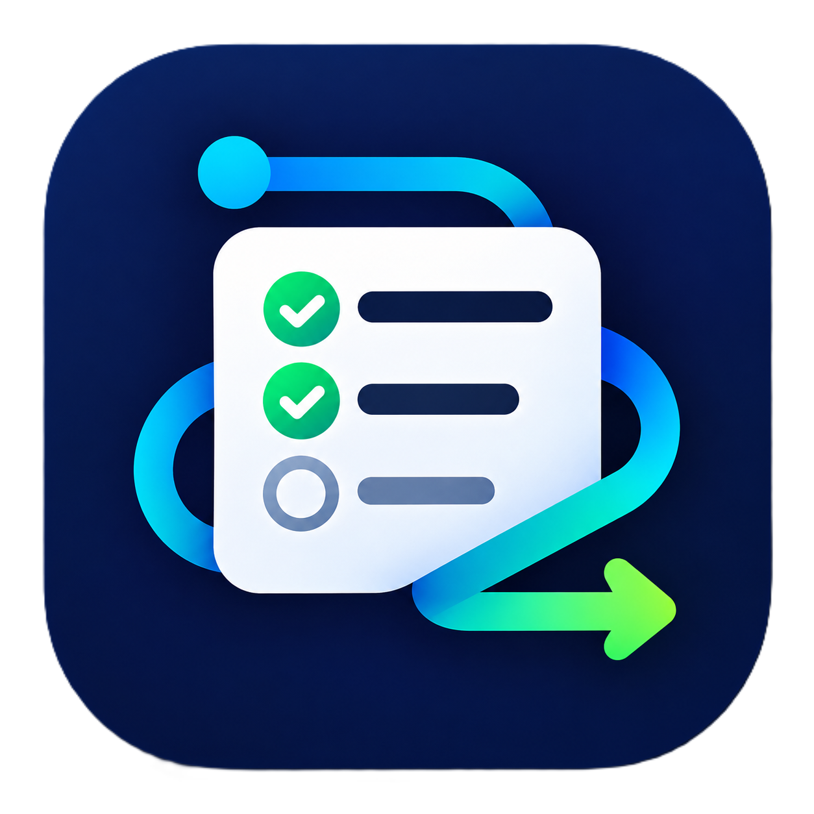

<p align="center">
  
</p>

<h1 align="center">TaskFlow</h1>

<p align="center">
  App Flutter de alarmas para tareas semanales.
</p>

App Flutter de alarmas para tareas semanales. Cada tarea tiene días de la semana
y hora; en Android suena una alarma nativa a pantalla completa (`AlarmActivity`)
con acciones Completar y Posponer (5 min, máximo 3 veces al día).

## Estado por plataforma

| Plataforma | Listado y edición | Alarmas |
|---|---|---|
| Android | Sí | Sí (nativa + notificación silenciosa de respaldo) |
| iOS | Sí | Notificación del sistema + diálogo en app |
| Escritorio (Windows/Linux/macOS) | Sí, como lista | No hay alarmas del sistema (aviso en app) |
| Web | Compila y abre, con aviso | No disponibles y sin guardado local |

## Requisitos

- Flutter estable reciente (probado con 3.47.2, Dart 3.13.2).
- Para Android: JDK 17 y Android SDK (los que pide el Flutter estable).
- Un dispositivo o emulador Android para probar las alarmas reales.

## Cómo compilar y ejecutar

```sh
cd taskflow
flutter pub get
flutter analyze
flutter test
flutter run            # dispositivo conectado o emulador
flutter build apk      # APK de release (firmado con debug por defecto)
flutter build web      # compila; con aviso de limitaciones en la app
```

## Permisos Android

La app declara `POST_NOTIFICATIONS`, `SCHEDULE_EXACT_ALARM` / `USE_EXACT_ALARM`,
`USE_FULL_SCREEN_INTENT`, `VIBRATE`, `WAKE_LOCK`, `RECEIVE_BOOT_COMPLETED`,
`SYSTEM_ALERT_WINDOW` y `REQUEST_IGNORE_BATTERY_OPTIMIZATIONS`.
Tres de ellos (`SYSTEM_ALERT_WINDOW`, `USE_EXACT_ALARM`,
`REQUEST_IGNORE_BATTERY_OPTIMIZATIONS`) están bajo escrutinio especial en
Google Play: ver el análisis en `../BUG_REPORT.md` (no se quitan porque las
alarmas exactas y la pantalla sobre otras apps son el núcleo de la app).

## Estructura

- `lib/main.dart`: UI principal y lógica de completado por ocurrencia.
- `lib/models/task.dart`: modelo (`completed` = detenida, `completedAt` = ocurrencia).
- `lib/database/database_helper.dart`: sqflite (v2) + `platform_info.dart`/`db_ffi.dart`
  para compilar en web.
- `lib/notification_service.dart`: notificaciones y puente al canal nativo.
- `android/.../kotlin/com/example/taskflow/`: `MainActivity`, `AlarmActivity`,
  `AlarmLaunchReceiver`, `AlarmBootReceiver`, `NativeAlarmHelper`.
- `test/`: unitarios (`task_test`, `snooze_test`, `snooze_key_test`) y widgets con
  BD mockeada (`widget_test.dart`).
